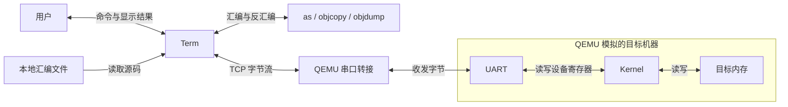
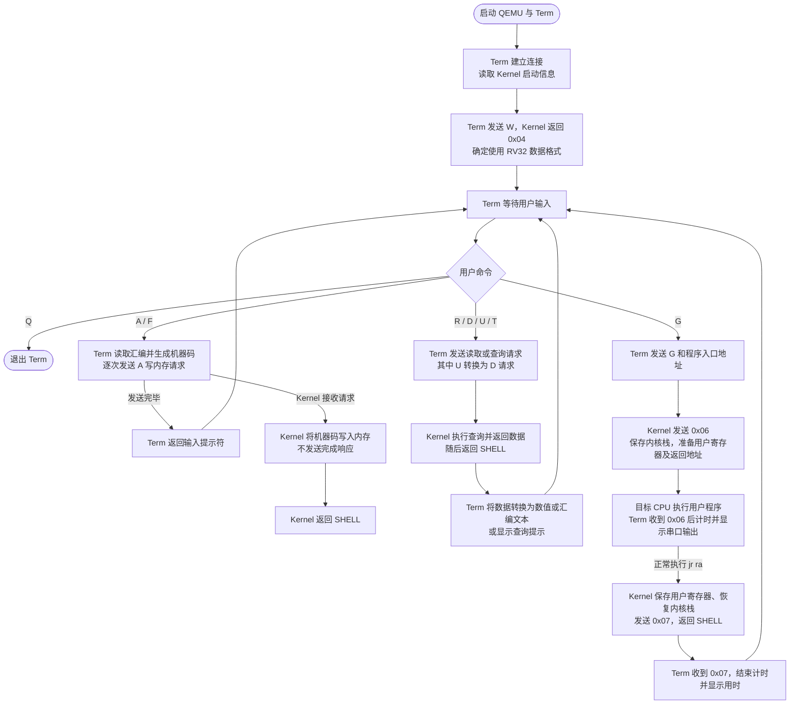
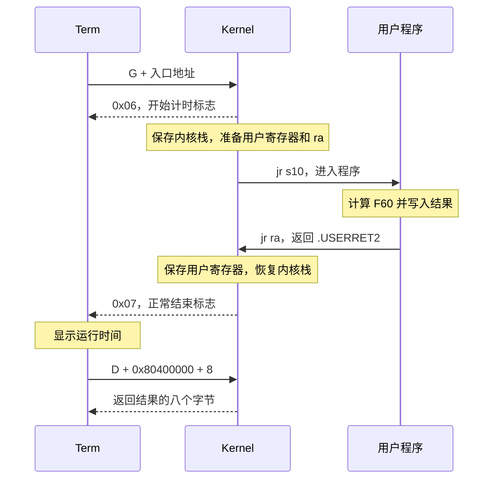

# 监控程序与终端程序代码分析报告

## 1. 程序整体结构

### 1.1 组成与职责

监控程序由 Kernel 和 Term 两部分组成，分别运行在目标计算机和实验者的电脑上。二者通过约定的命令和数据格式协同工作。

| 部分 | 运行位置 | 主要职责 |
| --- | --- | --- |
| Term | 实验者的电脑，使用 Python 运行 | 接收用户命令，读取汇编文件，调用汇编与反汇编工具，发送请求并显示结果 |
| Kernel | 目标计算机的 RISC-V CPU，执行汇编生成的机器码 | 初始化运行环境，接收命令，读写内存，保存用户寄存器状态，控制用户程序的启动与返回 |

以本实验中 QEMU 模拟的目标机器为例，各部分的关系如下：

Kernel 执行于 QEMU 模拟的目标机器内部。Term 连接 `127.0.0.1:6666`，QEMU 将 TCP 字节流与模拟 UART 的收发相连。Kernel 通过访问 UART 寄存器与 Term 通信。换成实际硬件后，目标 CPU、内存和串口由硬件提供，Term 仍按相同协议发送请求。



### 1.2 模块之间的关系

从功能上看，Term 负责将用户操作转换为协议请求，Kernel 负责在目标机器上完成具体操作。汇编和反汇编在 Term 一侧完成；Kernel 接收机器码并将其写入内存，或将内存中的原始字节返回给 Term。

Kernel 内部由初始化、命令分发和串口读写三个主要模块组成。`init.S` 准备运行环境后进入 `shell.S` 的命令循环；命令处理过程中需要收发数据时，再调用 `utils.S`。Term 内部则由连接管理、输入处理、工具调用和结果显示等函数配合完成一次用户操作。

Kernel 与用户程序共享目标 CPU 和内存。在基础版中，CPU 先执行 Kernel，收到 `G` 请求后跳到用户程序；用户程序返回后，再继续执行 Kernel。Term 在此期间仍运行于外部电脑，负责接收输出和等待结束标志。

## 2. 总体交互流程

下图概括从建立连接到完成一次命令的交互流程：



### 2.1 建立连接与进入命令循环

默认首次连接时，Term 建立通信连接，并读取 Kernel 初始化后输出的启动信息。随后，Term 发送 `W` 探测目标字长，Kernel 在本实验中返回 `0x04`。Term 据此选择 RV32 的数据宽度，并进入 `MainLoop()`；Kernel 则在 `SHELL` 中等待命令。

此时形成两个相互配合的循环：Term 等待用户输入，Kernel 等待串口中的请求。用户输入一次命令后，Term 才根据命令内容进行本地处理或向 Kernel 发送数据。

### 2.2 一次命令的处理过程

涉及目标机器操作的命令通常经过以下步骤：

| 阶段 | Term 的处理 | Kernel 的处理 |
| --- | --- | --- |
| 读取输入 | 接收命令、地址、长度或文件名，转换参数 | 在 `SHELL` 中等待命令字节 |
| 准备数据 | 根据需要读取文件、调用汇编工具，组织请求 | 继续等待请求 |
| 传输请求 | 按协议发送命令字节和后续参数、数据 | 接收命令并跳转到相应处理分支，再读取所需参数 |
| 执行操作 | 按命令约定接收返回数据，或在发送结束后返回提示符 | 读写内存、读取寄存器保存区，或启动用户程序 |
| 展示结果 | 将原始字节转换为数值、汇编文本或字符 | 操作完成后回到 `SHELL`，等待下一条命令 |

各命令的返回方式不同。`R`、`D` 按规定长度返回数据；`A` 写入内存后不单独发送完成响应；`G` 通过开始和结束标志界定运行过程。

### 2.3 运行用户程序时的控制切换

`G` 的处理跨越 Kernel 和用户程序两个执行阶段：Kernel 收到入口地址后发送 `0x06`，保存内核栈指针、准备用户寄存器和返回地址，再跳转到用户程序。Term 收到开始标志后计时，并持续接收运行期间的输出。

用户程序执行 `jr ra` 正常返回后，Kernel 保存其寄存器状态、恢复内核栈，发送 `0x07` 并回到命令循环。Term 收到结束标志后显示运行时间，再次等待用户输入。

```text
用户输入 G → Term 发送请求 → Kernel 准备运行环境
                                      ↓
                               CPU 执行用户程序
                                      ↓ jr ra
Term 显示用时 ← 接收结束标志 ← Kernel 保存状态并返回命令循环
```

在用户程序执行期间，基础版 Kernel 不再同时接收监控命令。后续的内存或寄存器查看，需要在用户程序返回后进行。

## 3. Kernel 的程序结构与主要功能

### 3.1 源文件分工

| 源文件 | 主要作用 |
| --- | --- |
| kernel/kern/evec.S | 放置在代码起始位置的入口代码，跳转到 `START` |
| kernel/kern/init.S | 初始化数据区、栈和串口，输出启动信息，进入命令循环 |
| kernel/kern/shell.S | 接收命令，完成内存读写、寄存器查看和用户程序运行 |
| kernel/kern/utils.S | 实现字节、字和字符串的串口读写 |
| kernel/kern/kernel32.ld | 规定各段的放置位置，定义栈顶及寄存器保存区相关符号 |
| kernel/include/common.h | 定义字长、访存宏、用户栈地址和运行控制信号 |
| kernel/include/serial.h | 定义串口寄存器地址、偏移和状态位 |
| kernel/include/exception.h | 定义寄存器保存位置等常量，基础版也使用其中的偏移宏 |
| kernel/kern/test.S | 提供内置测试程序 |

`trap.S` 中的异常处理代码由 `ENABLE_INT` 控制，本次构建未启用。在 RV32 配置下，`common.h` 中的 `LOAD`、`STORE` 分别展开为 `lw`、`sw`，`XLEN` 的值为 4。这里的 `XLEN` 使用字节作为单位。

### 3.2 内存布局

监控程序约定的主要地址区域如下：

| 地址范围 | 用途 |
| --- | --- |
| `0x80000000—0x800FFFFF` | Kernel 代码区域 |
| `0x80100000—0x803FFFFF` | 用户程序代码区域 |
| `0x80400000—0x807EFFFF` | 用户程序数据区域 |
| `0x807F0000—0x807FFFFF` | Kernel 数据和栈等区域 |
| `0x10000000—0x10000007` | 串口设备寄存器 |

### 3.3 启动与初始化

位于 `0x80000000` 的 `evec.S` 入口代码为：

```assembly
INITLOCATE:
    la s10, START
    jr s10
```

从 `0x80000000` 进入这段代码时，CPU 将 `START` 的地址装入 `s10`，再跳到 `init.S` 完成初始化。链接脚本通过 `ENTRY(START)` 指定 ELF 入口符号；该入口符号与放置在代码起始位置的 `INITLOCATE` 是两个不同的标签。

基础版中，`START` 的主要操作依次为：

1. 根据链接脚本定义的 `_sbss`、`_ebss`，逐字清零 BSS 区，使寄存器保存区等数据具有确定的初始值。
2. 将 `sp` 设置为内核栈初始地址，并在 `uregs_sp`、`uregs_fp` 中写入用户栈初始值，供启动用户程序时恢复。
3. 配置 UART16550 的 FIFO、波特率分频和数据格式等寄存器。
4. 在内核栈上分配并清零两块保存上下文的空间，初始化 `TCBT`、`current` 等数据结构。这些初始化代码在基础版中仍会执行，但基础版运行用户程序时不进行中断驱动的线程调度。
5. 跳到 `WELCOME`，调用 `WRITE_SERIAL_STRING` 输出启动信息，再跳到 `SHELL`。

初始化完成后，Kernel 持续执行“接收命令—执行操作—返回 `SHELL`”的循环。

### 3.4 串口读写

串口使用内存映射 I/O。Kernel 用访存指令访问串口寄存器，由串口设备完成数据收发。

| 地址及状态位 | 含义 |
| --- | --- |
| `0x10000000` | 正常收发配置下，读表示接收一个字节，写表示发送一个字节 |
| `0x10000005` 的 bit 0，掩码 `0x01` | 接收数据就绪 |
| `0x10000005` 的 bit 5，掩码 `0x20` | 发送保持寄存器空，可以写入下一个字节 |

`utils.S` 的 `READ_SERIAL` 轮询接收就绪位，再用 `lb` 从数据寄存器读取一个字节，结果放入 `a0`。由于 `lb` 会符号扩展，接收字节应取 `a0` 的低 8 位；`READ_SERIAL_WORD` 在拼接数据前会使用 `andi 0xFF` 保留各字节。`WRITE_SERIAL` 等待发送就绪后，使用 `sb` 将 `a0` 的低 8 位写入数据寄存器。基础版的实际收发采用轮询方式。

在字节收发函数的基础上，`READ_SERIAL_WORD` 连续接收四个字节，通过移位和按位或组合成一个 32 位数；`WRITE_SERIAL_WORD` 按低字节到高字节的顺序发送四个字节。`READ_SERIAL_XLEN`、`WRITE_SERIAL_XLEN` 在 RV32 下处理四字节数据。`WRITE_SERIAL_STRING` 按字节发送以零结尾的字符串，不发送末尾的零。

地址、长度、机器指令和寄存器值都通过多次字节收发传输，协议中的多字节整数采用小端序。

### 3.5 命令接收与分发

`shell.S` 的 `SHELL` 首先调用 `READ_SERIAL` 读取一个命令字节，将其与 `R`、`D`、`A`、`G`、`T` 比较，然后跳到相应分支。普通命令处理完成后，经 `.DONE` 返回 `SHELL`。

| 处理分支 | 具体操作 |
| --- | --- |
| `.OP_R` | 将 `uregs` 中对应 `x1` 到 `x31` 的 124 字节逐字节发送给 Term |
| `.OP_D` | 接收地址和字节数，逐字节读取指定内存并发送给 Term |
| `.OP_A` | 接收地址和字节数，再接收数据，每四字节组成一字，使用 `sw` 写入内存 |
| `.OP_G` | 接收入口地址，准备用户寄存器，跳转到用户程序，返回后保存状态 |
| `.OP_T` | 基础版未启用页表，返回 `0xFFFFFFFF`，由 Term 提示页表未启用 |

对于没有匹配到的命令，Kernel 发送一个值为 `XLEN` 的字节。Term 启动时发送的 `W` 正是利用这一分支探测目标字长。

### 3.6 用户程序的启动与返回

`.OP_G` 首先调用 `READ_SERIAL_XLEN` 读取入口地址，保存在 `s10` 中，再发送 `SIG_TIMERSET=0x06`，通知 Term 开始计时。

随后，Kernel 将自己的栈指针保存到 `uregs + TF_ksp` 位置，从 `uregs` 恢复用户程序使用的通用寄存器。这里有两个特殊处理：`ra` 需要设置为返回 Kernel 的地址；`s10` 用来保存本次程序入口，因此这两个寄存器不直接从上次保存值恢复。

进入用户程序的关键代码为：

```assembly
    la ra, .USERRET2
    jr s10
```

用户程序执行末尾的 `jr ra` 后，CPU 回到 `.USERRET2`。该分支保存用户寄存器，恢复 Kernel 栈指针，将 `.USERRET2` 的地址写入 `ra` 对应的保存槽，然后发送 `SIG_TIMETOKEN=0x07`，最后返回命令循环。

因此，`R` 命令读到的是内存中保存的用户寄存器状态；其中基础版的 `ra` 槽由返回代码设置为 `.USERRET2`。用户程序如果调用其他函数，需要保存和恢复用于返回 Kernel 的 `ra`。

## 4. Term 的程序结构与主要功能

Term 的主要代码集中在 term/term.py中，可以按功能分为连接管理、命令处理、汇编工具调用和数据转换四部分。

### 4.1 功能划分

| 函数或类 | 作用 |
| --- | --- |
| `InitializeTCP()`、`tcp_wrapper` | 建立 TCP 连接，将套接字封装为统一的读写接口 |
| `InitializeSerial()` | 使用 pyserial 打开实际串口 |
| `test_programs()` | 检查 `as`、`objcopy`、`objdump` 是否可调用 |
| `Main()` | 读取启动信息，探测目标字长，进入交互循环 |
| `MainLoop()` | 读取命令及参数，调用对应处理函数 |
| `run_A()`、`run_F()` | 读取汇编输入、生成机器码并发送写内存请求 |
| `run_D()`、`run_R()` | 读取内存或已保存的寄存器数据，转换并显示 |
| `run_U()` | 读取机器码并调用反汇编函数显示结果 |
| `run_G()` | 请求运行用户程序，处理输出和运行时间 |
| `multi_line_asm()` | 调用汇编器和 `objcopy`，返回机器码字节串 |
| `single_line_disassmble()` | 调用 `objdump`，返回一条指令的反汇编结果 |
| `int_to_byte_string()` 等 | 在 Python 整数与小端字节串之间转换 |

串口连接和 TCP 连接最终都赋给 `inp`、`outp`，上层处理函数通过 `inp.read()` 和 `outp.write()` 通信。因此，大部分命令处理代码不需要区分底层连接方式。

`tcp_wrapper.read(n)` 会循环接收，直到累计取得 `n` 个字节；`write()` 则循环发送，直到待发送数据全部写出。这样，上层命令可以按照协议规定的长度读取数据，而不依赖一次 TCP 接收恰好得到完整数据。

### 4.2 启动与连接检查

程序从 `if __name__ == "__main__"` 开始执行，先解析命令行参数。本实验使用 `-t 127.0.0.1:6666`，因此调用 `InitializeTCP()` 连接 QEMU；使用实际串口时，则由 `-s` 参数选择 `InitializeSerial()`。

建立连接后，Term 检查外部工具是否可用，再进入 `Main()`。默认情况下，Term 先读取并显示启动信息，然后执行字长探测：

```python
outp.write(b'W')
xlen = ord(inp.read(1))
```

Kernel 的 `SHELL` 没有单独的 `W` 分支，收到 `W` 后执行未匹配命令的处理代码：

```assembly
    li a0, XLEN
    jal WRITE_SERIAL
```

Term 收到 `0x04` 时，将目标设为 RV32；收到 `0x08` 时，将目标设为 RV64。本实验收到的值为 `0x04`。这一步既确定后续地址和寄存器值的传输宽度，也检查了 Kernel 是否能够接收并响应命令。TCP 连接建立只说明传输通道已连通，`W` 的响应进一步确认了监控协议能够交互。

完成探测后，`Main()` 调用 `MainLoop()`，开始显示 `>>` 提示符并等待用户输入。

### 4.3 命令处理与外部工具调用

`MainLoop()` 对命令字符串去除首尾空白并转成大写，在分派前调用 `EmptyBuf()` 清理本地接收缓冲区，再读取相应参数，调用对应的 `run_*` 函数。清理缓冲区只处理本地已接收的数据，不会改变目标 CPU 的执行状态。地址参数通过 `int(addr, 16)` 转为十六进制整数，`D`、`U` 的长度参数通过 `int(num)` 按十进制读取。

`A` 和 `F` 的差别主要在输入来源：`A` 从键盘逐行接收汇编，以空行结束；`F` 从用户指定的本地文件读取汇编。两者都将输入整理为汇编文本，交给 `multi_line_asm()` 处理。

`multi_line_asm()` 的处理过程为：

1. 将汇编文本写入临时文件。
2. 调用 `riscv64-unknown-elf-as`，在本实验中使用 `-march=rv32i`，生成目标文件。
3. 调用 `riscv64-unknown-elf-objcopy`，提取 `.text` 段，生成原始机器码。
4. 读取机器码字节串并返回，最后清理临时文件。

得到机器码后，`run_A()` 和 `run_F()` 每次发送四字节数据。对应的发送代码为：

```python
outp.write(b'A')
outp.write(int_to_byte_string(addr))
outp.write(int_to_byte_string(4))
outp.write(binary[i:i+4])
```

`F` 在 Kernel 一侧对应一系列 `A` 写内存请求。文件路径由 Term 使用，标签和注释由汇编过程处理，最终发送到 Kernel 的是机器码。

`run_U()` 也使用了已有的 Kernel 功能：它发送 `D` 请求读取内存，每次取得四字节机器码，再调用 `single_line_disassmble()`，使用 `objdump` 得到汇编文本。Kernel 只需完成内存读取，反汇编由 Term 一侧的工具完成。

`run_D()` 将接收的数据每四字节解释为一个小端 32 位数，并显示地址和十六进制数值。`run_R()` 按 `x1` 到 `x31` 的顺序接收保存值，再结合 `Reg_alias` 显示寄存器名称。

### 4.4 运行输出、计时和退出

`run_G()` 发送 `G` 和入口地址后，读取开始标志 `0x06`，调用 `timer()` 记录起始时间。接着逐字节接收数据：普通字节交给 `output_binary()` 输出；收到结束标志 `0x07` 后退出接收循环，计算时间差并显示 `elapsed time`。

计时由 Term 完成，Kernel 负责发送开始和结束标志。Kernel 在恢复用户寄存器之前发送 `0x06`，在保存返回状态之后发送 `0x07`。Term 在主机端根据这些标志记录时间差

`MainLoop()` 收到 `Q` 后直接退出循环，不向 Kernel 发送退出命令。它还捕获 `KeyboardInterrupt`，因此在 Term 按 `Ctrl+C` 可以中断本地等待，但不会自动停止目标 CPU。基础版 Kernel 需要等用户程序正常返回后，才能继续接收监控命令。

## 5. Term 与 Kernel 的通信协议

### 5.1 数据格式

命令使用一个字节表示。地址和长度在 RV32 下各占四字节，按照小端序发送。Term 中的 `struct.pack('<I', val)` 与 Kernel 中的 `READ_SERIAL_WORD` 使用相同的字节顺序。

例如，地址 `0x80400000` 的传输字节为：

```text
00 00 40 80
```

RV32 基础版主要请求及响应如下：

| 请求 | Term 发送的数据 | Kernel 返回的数据或行为 |
| --- | --- | --- |
| 字长探测 | `W` | 一个字节 `0x04` |
| 查看寄存器 | `R` | `x1` 到 `x31` 保存值，共 124 字节 |
| 读取内存 | `D` + 地址 4 字节 + 长度 4 字节 | 指定长度的原始内存数据 |
| 写入内存 | `A` + 地址 4 字节 + 长度 4 字节 + 数据 | 将数据写入指定地址；该分支没有单独的完成响应 |
| 执行程序 | `G` + 入口地址 4 字节 | `0x06` + 运行期间输出 + 正常返回标志 `0x07` |
| 查询页表 | `T` | 基础版返回四字节 `FF FF FF FF` |

正常使用时，内存读写的长度取正值。`A` 的长度应为四字节的倍数，当前 Term 每个 `A` 请求发送四字节。`run_D()`、`run_U()` 只检查长度是否为四的倍数，并未检查长度是否大于零；它们按四字节显示数据或反汇编。

`F`、`U` 和 `Q` 属于 Term 的界面命令，分别通过 `A`、`D` 和本地退出实现，不作为对应的命令字节发送给 Kernel。

### 5.2 外部交互的分工

| 交互对象 | 对应代码及处理方式 |
| --- | --- |
| 用户 | Term 的 `MainLoop()` 读取命令和参数，`print()`、`output_binary()` 显示结果 |
| 本地汇编文件 | Term 的 `run_F()` 检查文件是否存在并读取内容 |
| 汇编及反汇编工具 | Term 通过 `subprocess` 调用 `as`、`objcopy` 和 `objdump` |
| TCP 或实际串口 | Term 使用 `tcp_wrapper` 或 pyserial，通过统一的 `inp`、`outp` 接口收发字节 |
| 目标串口设备 | Kernel 的 `utils.S` 轮询 UART 状态，读写数据寄存器 |
| 目标内存 | Kernel 的 `.OP_A`、`.OP_D` 读写指定区域，`.OP_R` 读取寄存器保存区 |
| 用户程序 | Kernel 的 `.OP_G` 准备寄存器和返回地址后跳转，`.USERRET2` 处理返回状态 |

## 6. 实际案例分析

以 fib60.s 为例，程序入口设为 `0x80100000`，结果保存到从 `0x80400000` 开始的八个字节中。具体交互过程如下。

1. Term 已完成连接与字长探测，Kernel 在 `SHELL` 中等待命令。
2. 用户输入 `F`，指定文件和加载地址。Term 读取 `fib60.s`，调用汇编工具得到机器码。
3. Term 连续发送 `A` 请求，每次写入四字节。Kernel 在 `.OP_A` 中将数据写入指定地址，随后返回 `SHELL`。
4. 用户输入 `U`，检查装入的程序。Term 发送 `D` 请求读回机器码，调用 `objdump` 反汇编并显示。
5. 用户输入 `G` 和入口地址。Kernel 发送 `0x06`，准备寄存器和返回地址，跳到 `0x80100000`。
6. CPU 执行 Fibonacci 程序，将低 32 位和高 32 位分别写入 `0x80400000`、`0x80400004`，然后执行 `jr ra`。
7. Kernel 在 `.USERRET2` 保存寄存器，恢复内核栈，发送 `0x07`，回到 `SHELL`。Term 结束计时并显示用时。
8. 用户输入 `D`，地址为 `0x80400000`、长度为 8。Kernel 返回八字节数据，Term 按两个 32 位数显示结果。

正常运行阶段的交互时序如下：




