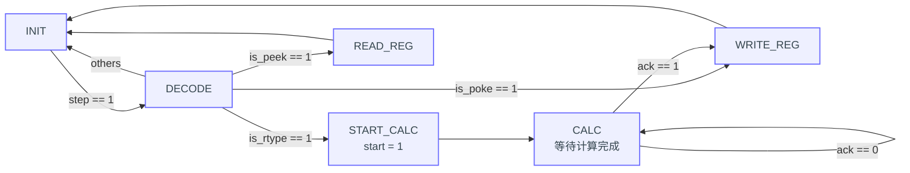

## 1. 仿真验证

### 1.1 ALU 仿真验证

```
        // ADD：5 + 3 = 8，预期 y = 0008
        a = 16'd5;
        b = 16'd3;
        op = 4'd1;
        #10;
        // SUB：5 - 3 = 2，预期 y = 0002
        a = 16'd5;
        b = 16'd3;
        op = 4'd2;
        #10;
        // AND：按位与，预期 y = 00F0
        a = 16'hF0F0;
        b = 16'h0FF0;
        op = 4'd3;
        #10;
        // OR：按位或，预期 y = FFF0
        a = 16'hF0F0;
        b = 16'h0FF0;
        op = 4'd4;
        #10;
        // XOR：按位异或，预期 y = FF00
        a = 16'hF0F0;
        b = 16'h0FF0;
        op = 4'd5;
        #10;
        // NOT：对 a 按位取反，预期 y = 0F0F
        a = 16'hF0F0;
        b = 16'd0;
        op = 4'd6;
        #10;
        // SLL：逻辑左移 4 位，预期 y = 2340
        a = 16'h1234;
        b = 16'd4;
        op = 4'd7;
        #10;
        // SRL：逻辑右移 1 位，预期 y = 4000
        a = 16'h8001;
        b = 16'd1;
        op = 4'd8;
        #10;
        // SRA：算术右移 1 位，预期 y = C000
        a = 16'h8001;
        b = 16'd1;
        op = 4'd9;
        #10;
        // ROL：循环左移 1 位，预期 y = 0003
        a = 16'h8001;
        b = 16'd1;
        op = 4'd10;
        #10;
        // 边界情况测试
        // 加法溢出：FFFF + 1，预期 y = 0000
        a = 16'hFFFF;
        b = 16'd1;
        op = 4'd1;
        #10;
        // 减法：0 - 1，预期 y = FFFF
        a = 16'd0;
        b = 16'd1;
        op = 4'd2;
        #10;
        // 左移 0 位，保持原值，预期 y = 8001
        a = 16'h8001;
        b = 16'd0;
        op = 4'd7;
        #10;
        // b = 16，实际移位量 b[3:0] = 0
        // 预期 y = 8001
        a = 16'h8001;
        b = 16'd16;
        op = 4'd7;
        #10;
        // b = 17，实际移位量 b[3:0] = 1
        // 算术右移 1 位，预期 y = C000
        a = 16'h8001;
        b = 16'd17;
        op = 4'd9;
        #10;
        // 较大的 b，实际移位量为 3
        // 预期 y = 6D30
        a = 16'h8DA6;
        b = 16'h8D93;
        op = 4'd7;
        #10;
```


- 第一步：输入操作数 5 和 3，分别测试加法和减法，检查结果是否为 8 和 2，验证基本算术运算功能。
- 第二步：依次测试按位与、按位或、按位异或和按位取反，检查各操作码是否能够得到正确的逻辑运算结果。
- 第三步：依次测试逻辑左移、逻辑右移、算术右移和循环左移，检查移位结果，重点验证逻辑右移补 0、算术右移补符号位，以及循环左移将最高位移回最低位的行为。
- 第四步：测试 `0xFFFF + 1` 和 `0 - 1`，预期结果分别为 `0x0000` 和 `0xFFFF`，检查加减法边界情况下是否正确保留低 16 位。
- 第五步：设置移位量为 0、16、17 和较大的数，检查移位量是否按照操作数 `b` 对 16 取模，即取 `b[3:0]`。


### 1.2 regfile 仿真验证

```
		// 复位，并让两个读端口分别观察 x1、x2
        rst = 1;
        we = 0;
        waddr = 0;
        wdata = 0;
        raddr_a = 1;
        raddr_b = 2;
        #10;

        // 向 x1 写入 5
        rst = 0;
        we = 1;
        waddr = 1;
        wdata = 16'd5;
        #10;

        // 向 x2 写入 3
        waddr = 2;
        wdata = 16'd3;
        #10;

        // 关闭写使能：尝试修改 x1，x1 应保持为 5
        we = 0;
        waddr = 1;
        wdata = 16'd9;
        #10;

        // 尝试向 x0 写入 9，并用端口 A 读取 x0（应该保持0）
        we = 1;
        waddr = 0;
        wdata = 16'd9;
        raddr_a = 0;
        #10;

        // 停止写入，再用端口 B 读取 x0
        we = 0;
        raddr_b = 0;
        #10;

        // 重新观察 x1、x2，并拉高复位
        we = 0;
        raddr_a = 1;
        raddr_b = 2;
        rst = 1;
        #10;

        // 释放复位，观察数据是否保持为 0
        rst = 0;
        #10;
```


- 第一步：拉高复位信号，检查寄存器是否在时钟上升沿清零，建立初始状态。
- 第二步：依次向 x1、x2 写入 5 和 3，并通过两个读端口读取，检查数据能否在时钟上升沿写入，以及两个读端口能否正常工作。
- 第三步：关闭写使能，尝试将 x1 改为 9，检查 x1 是否仍然保持为 5，验证写使能的控制作用。
- 第四步：向 x0 写入 9，再分别通过两个读端口读取 x0，检查结果是否始终为 0。
- 第五步：重新读取 x1、x2，并再次拉高复位信号，检查原来的 5 和 3 是否在随后的时钟上升沿清零，验证同步复位功能。

### 1.3 整体仿真

```
initial begin
    // 初始化外部输入
    dip_sw = 32'd0;
    touch_btn = 4'd0;
    push_btn = 0;
    reset_btn = 1;

    // 释放外部复位
    #200;
    reset_btn = 0;

    // 等待 PLL 时钟稳定，以及内部复位释放
    wait (dut.locked === 1'b1);
    wait (dut.reset_of_clk10M === 1'b0);

    // 从内部时钟的下降沿开始安排后面的输入
    @(negedge dut.clk_10M);

    // 1. POKE：x1 = 5
    dip_sw = `inst_poke(5'd1, 16'd5);
    #200;
    push_btn = 1;
    #200;
    push_btn = 0;
    #1000;

    // 2. POKE：x2 = 3
    dip_sw = `inst_poke(5'd2, 16'd3);
    #200;
    push_btn = 1;
    #200;
    push_btn = 0;
    #1000;

    // 3. ADD：x3 = x1 + x2 = 8
    dip_sw = `inst_rtype(5'd3, 5'd1, 5'd2, ADD);
    #200;
    push_btn = 1;
    #200;
    push_btn = 0;
    #1000;

    // 4. PEEK：读取 x3，预期 leds = 0008
    dip_sw = `inst_peek(5'd3, 16'd0);
    #200;
    push_btn = 1;
    #200;
    push_btn = 0;
    #1000;

    // 5. SUB：x4 = x1 - x2 = 2
    dip_sw = `inst_rtype(5'd4, 5'd1, 5'd2, SUB);
    #200;
    push_btn = 1;
    #200;
    push_btn = 0;
    #1000;

    // 6. PEEK：读取 x4，预期 leds = 0002
    dip_sw = `inst_peek(5'd4, 16'd0);
    #200;
    push_btn = 1;
    #200;
    push_btn = 0;
    #1000;

    $finish;
end
```


- 第一步：通过拨码开关和按键输入两条 POKE 指令，将 5 和 3 分别写入 x1、x2，为后续运算准备操作数。
- 第二步：执行 ADD 指令，将 x1 与 x2 相加并写入 x3，再执行 PEEK 读取 x3，检查 LED 是否显示 8，验证加法指令的完整执行流程。
- 第三步：执行 SUB 指令，将 x1 减去 x2 的结果写入 x4，再执行 PEEK 读取 x4，检查 LED 是否显示 2，验证减法指令的完整执行流程。
- 在两次运算后都使用 PEEK 检查结果，同时观察 LED 是否只在执行 PEEK 后更新。

## 2. 云平台实验

### 2.1 指令序列

先用POKE写入数据：

1. 向x1写入5：0005008A
2. 向x2写入3：0003010A

测试ADD指令：

3. ADD(x3=x1+x2)：00208189
4. PEEK(展示结果)：00000192

测试SUB指令：

5. SUB(x4=x1-x2)：00208211
6. PEEK：00000212

### 2.2 实际测试

执行完ADD后，再通过PEEK读取结果，3+5=8故只有D4亮


执行 SUB 后，再通过 PEEK 读取 x4。由于 5−3=2，因此只有 D2 亮。


## 3. 思考题

假设需要你的 ALU 支持乘法和除法运算，而这些运算均不能在一个周期内完成，应该如何改动你的状态机？给出新的状态转移图，并做简要说明。

首先需要改造ALU：增加时序逻辑，接收到 `start` 后开始计算，经过若干个时钟周期完成运算，再输出 `ack`。

控制逻辑的状态机增加`START_CALC`状态，用于发送`start`信号启动计算，启动后进入`CALC`状态，`CALC`状态只有计算完成`ack=1`后才进入下一个`WRITE`状态



